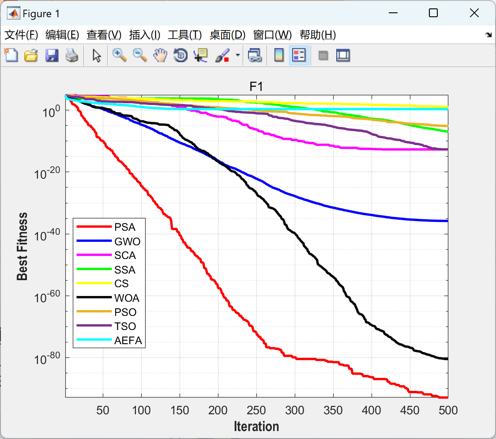

# [October 2023] The latest optimization algorithm for [Various Algorithms] Spread Search Algorithm: Engineering Application Optimization Algorithm Based on Physics Field (Matlab Code Implementation)

[October 2023 Update][Latest Optimization Algorithms]Comparative Analysis of Various Algorithms
Propagation Search Algorithm: Engineering Application Optimization Algorithm Based on Physical Field (Matlab Code Implementation)

## Images

<!-- PAYMENT_BLOCK -->

## Get this dataset

- Payment link (Stripe): [Buy now](https://buy.stripe.com/3cs8yP7sY87d0vu9AB)
- Payment QR code: 

<!-- /PAYMENT_BLOCK -->
